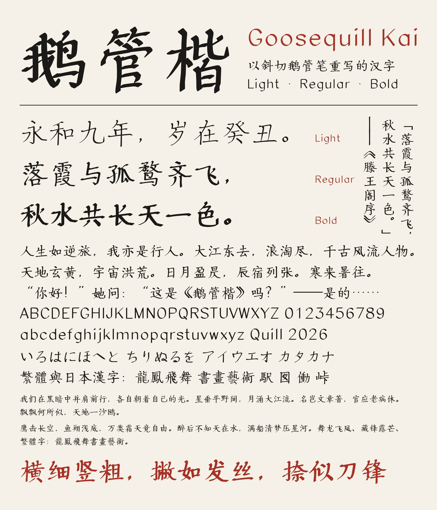

# 鹅管楷 / Goosequill Kai

用一支**斜切的鹅管笔**（西方书法的扁平笔尖）把汉字重新写一遍的开源中文字体。
An open-source Chinese typeface whose every stroke is re-written by a simulated slanted broad-nib goose quill.



## 这是什么

绝大多数中文字体以毛笔或硬笔为原型。鹅管楷换了一支笔：笔尖是一条固定 33° 倾角的扁平切口，笔画粗细不由“提按”决定，而由**运笔方向与笔尖的夹角**决定——

- **横细竖粗**：横画约为竖画的三分之二；
- **撇如发丝、捺似刀锋**：撇、提顺着笔尖方向，收成细线；捺垂直于笔尖，最重；
- **起笔一顿、钩处收锋**：起笔略宽，钩与撇的末端逐渐提笔；
- **密字自动减细**：笔画越多，笔越细，避免糊成一团。

整套字不是手绘的，而是由 `sources/` 里的程序生成：骨架 + 笔 = 字。改一个参数（笔宽、笔尖角度、笔尖厚度）就能得到一套新的字。

## 字重与字汇

| 文件 | 字重 |
| --- | --- |
| `fonts/TTF/GoosequillKai-Light.ttf` | Light 300 |
| `fonts/TTF/GoosequillKai-Regular.ttf` | Regular 400 |
| `fonts/TTF/GoosequillKai-Bold.ttf` | Bold 700 |

`fonts/WOFF2/` 下是对应的网页字体。

- **汉字 11600 余个**：简体常用字、繁体字、日本新字体与部分部首部件；
- **假名 177 个**：平假名、片假名（含小写假名、浊音、长音符）；
- **西文**：ASCII 拉丁字母、数字、符号及其全角形式；
- **中文标点**：，。、：；！？“”‘’（）《》〈〉「」『』【】—…·～
- **竖排**：内置 `vert` / `vrt2` 特性与竖排度量，标点在竖排时自动换成竖排形式（︐︒︑︵︶﹁﹂︽︾ 等）；
- **常用符号**：× ÷ ± ° ¥ • → ← ↑ ↓ 〇

**已知不足**：没有注音、谚文；未做 hinting，小字号下细笔画偏淡，更适合标题与展示用途；竖排时小写假名、引号（“”）未做专门调整；西文骨架来自工程制图用的单线字体，比专业西文设计朴素；个别字的笔画衔接不够理想——欢迎提 Issue 附上具体的字。

## 构建

```bash
pip install -r requirements.txt
make data      # 获取笔画骨架数据（Make Me a Hanzi、AnimCJK）
make build     # 生成三个字重，输出到 fonts/
```

只想调参试几个字：

```bash
python3 sources/build.py Regular --only "永和九年"
```

主要参数在 `sources/build.py` 的 `WEIGHTS`（笔宽 `W`、笔尖厚 `T`）和 `sources/quill.py` 的 `P`（笔尖角度 `ANG` 等）。

## 致谢与来源

- 版式度量（字框、行高）参考了 [霞鹜文楷 LXGW WenKai](https://github.com/lxgw/LxgwWenKai)，以便与其混排；未使用其任何字形。
- 汉字笔画骨架来自 [Make Me a Hanzi](https://github.com/skishore/makemeahanzi) 的 `graphics.txt`，该数据衍生自文鼎 PL 简中楷（Arphic PL KaitiM GB）与文鼎 PL 中楷（Arphic PL UKai）。
- 假名、繁体字与日本汉字的骨架来自 [AnimCJK](https://github.com/parsimonhi/animCJK) 的 `graphics*.txt`（同样衍生自文鼎字体，以 Arphic Public License 发布）。同一个字在多份数据中出现时，优先用 Make Me a Hanzi 的版本。
- 西文骨架来自 Hershey Simplex 单线字体（经由 [HersheyFonts](https://github.com/apshu/HersheyFonts)）。The Hershey Fonts were originally created by Dr. A. V. Hershey while working at the U.S. National Bureau of Standards.
- 字形轮廓由本项目的程序生成，设计与程序由项目作者与 Claude（Anthropic）协作完成。

## 授权

- **字体文件**（`fonts/`）：由于汉字骨架衍生自文鼎字体，按 [文鼎公众授权书 Arphic Public License](LICENSE) 发布。可以自由使用、复制、修改、再分发（含商用），但修改版必须同样以该授权发布并保留版权声明。
- **程序代码**（`sources/*.py`、`Makefile`）：MIT，见 [LICENSE-CODE](LICENSE-CODE)。

本说明不构成法律意见；如有严格的合规要求，请自行审阅授权原文。
